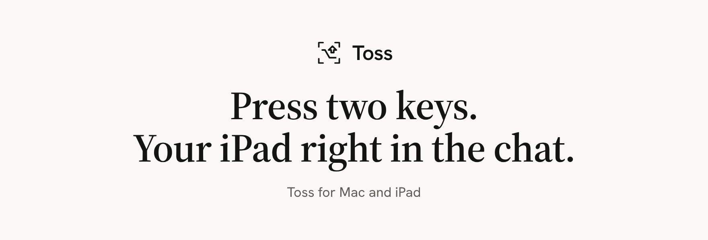
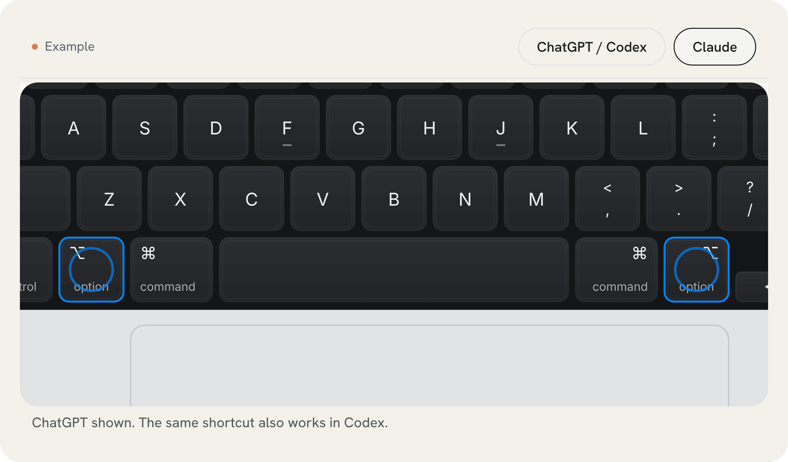
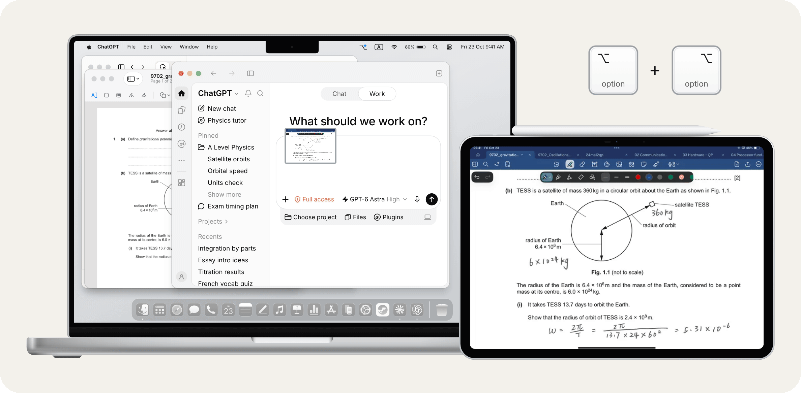

  <picture>
    <source media="(prefers-color-scheme: dark)" srcset="docs/images/banner-dark.png">
    
  </picture>

Toss is a Mac menu-bar app that drops a screenshot of your iPad into the ChatGPT, Codex or Claude chat you have open. It only adds the picture to your draft; you still press Send.

  <picture>
    <source media="(prefers-color-scheme: dark)" srcset="docs/images/demo-shortcut-dark.gif">
    
  </picture>

## Shortcuts

| Press together | Goes to |
| --- | --- |
| Left <kbd>⌥ Option</kbd> + right <kbd>⌥ Option</kbd> | ChatGPT / Codex |
| Left <kbd>⇧ Shift</kbd> + right <kbd>⇧ Shift</kbd> | Claude |

Works over USB or Wi‑Fi, whichever is connected.

## Works wherever the chat window is

Toss brings the right window forward first, then captures and attaches.

  <picture>
    <source media="(prefers-color-scheme: dark)" srcset="docs/images/demo-any-window-dark.gif">
    
  </picture>

## Get started

1. Download the latest [release](https://github.com/Anzene057/Toss/releases/latest) and drag Toss into Applications.
2. Connect your iPad with a USB data cable the first time, tap **Trust** and turn on **Developer Mode**. Toss guides you through it.
3. After that, pairing is done. Toss reconnects by itself.

Needs an Apple silicon Mac with macOS 14+, and an iPad with iPadOS 17+ (17.4+ for USB).

## License

[MIT](LICENSE)
