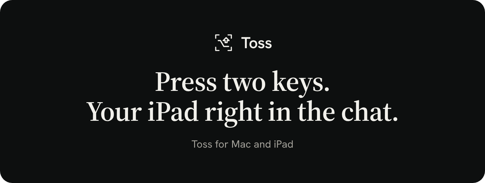
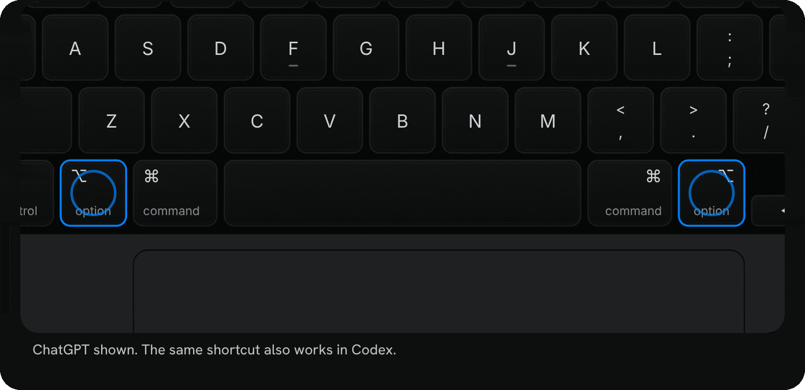
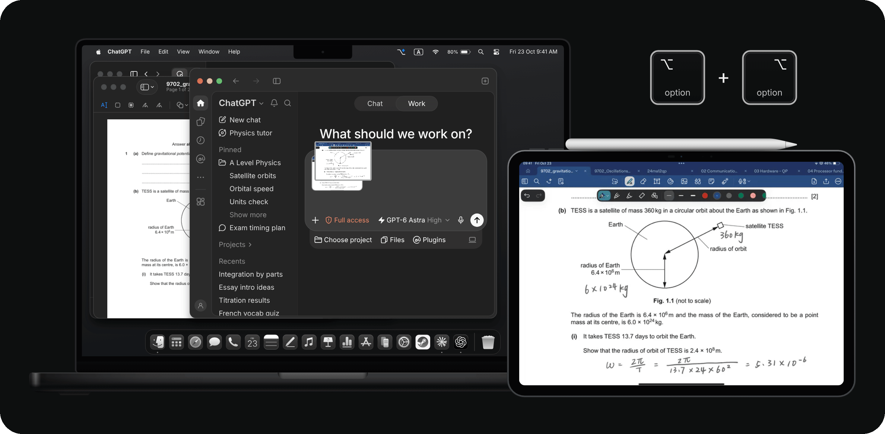

  

Toss is a Mac menu-bar app that drops a screenshot of your iPhone or iPad into the ChatGPT, Codex or Claude chat you have open. It only adds the picture to your draft; you still press Send.

  

## Shortcuts

| Press together | Goes to |
| --- | --- |
| Left <kbd>⌥ Option</kbd> + right <kbd>⌥ Option</kbd> | ChatGPT / Codex |
| Left <kbd>⇧ Shift</kbd> + right <kbd>⇧ Shift</kbd> | Claude |

Works over USB or Wi‑Fi, whichever is connected. With both devices paired, press once for iPad or twice quickly for iPhone.

## Works wherever the chat window is

Toss brings the right window forward first, then captures and attaches.

  

## Get started

1. Open the iPhone+iPad disk image and double-click **Toss Installer**. Drag Toss into Applications in its window; setup opens automatically.
2. Connect your iPhone or iPad with a USB data cable the first time, tap **Trust** and turn on **Developer Mode**. Toss guides you through it.
3. After that, pairing is done. Toss reconnects by itself.

Until at least one iPhone or iPad is paired, opening Toss from the Dock or clicking its menu-bar icon reopens the setup guide.

Needs an Apple silicon Mac with macOS 14+, and an iPhone or iPad with iOS or iPadOS 17+ (17.4+ for USB).

## License

[MIT](LICENSE)
