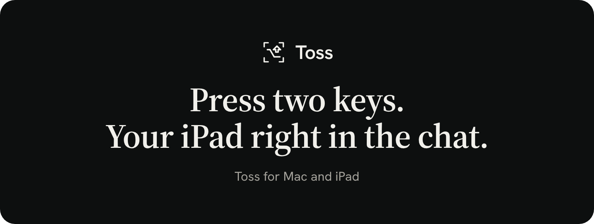
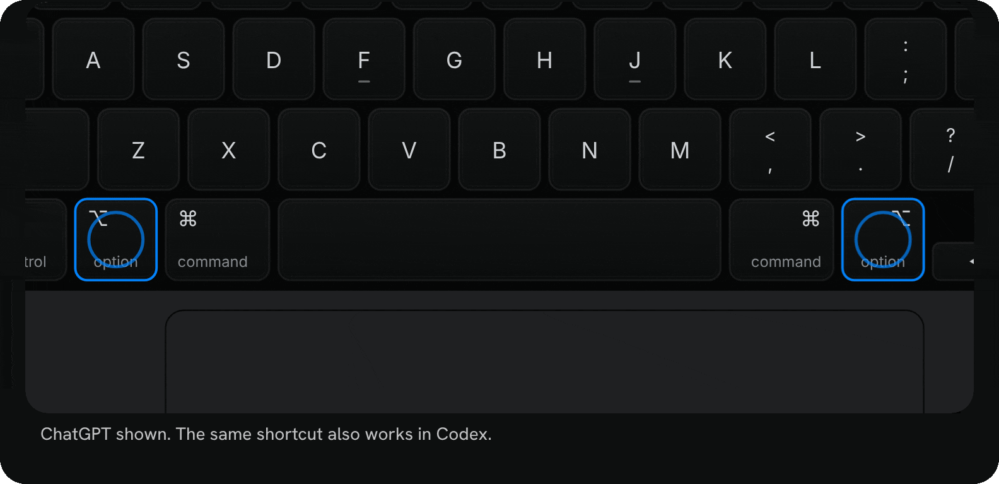
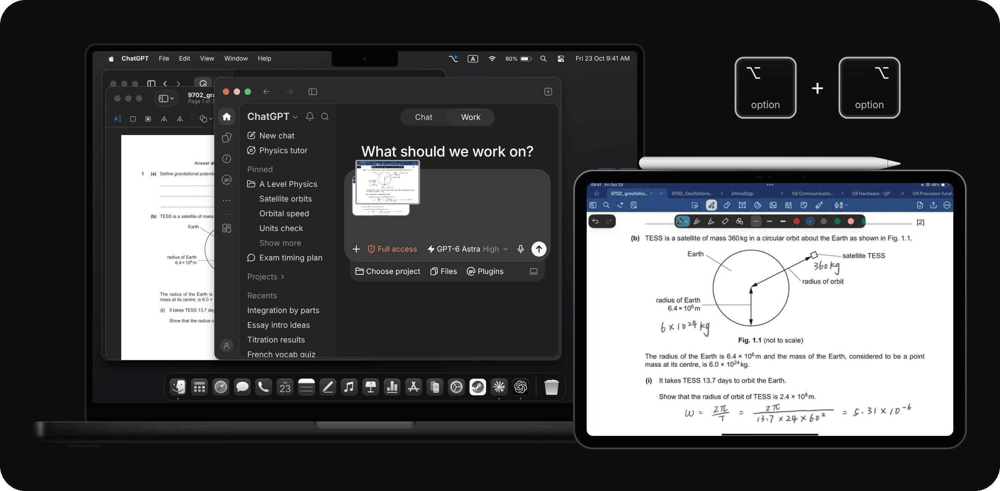
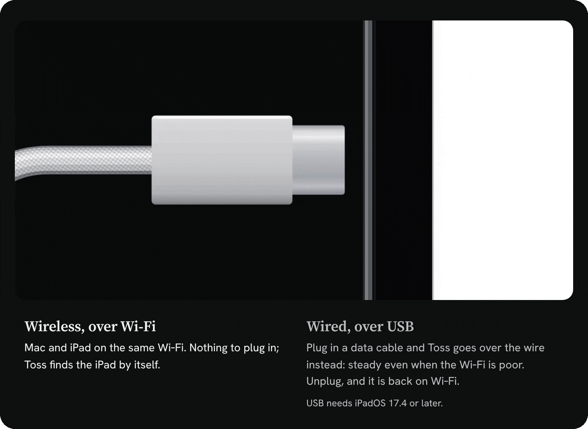

  

Toss is a Mac menu-bar app that drops a screenshot of your iPad into the ChatGPT, Codex or Claude chat you have open. It only adds the picture to your draft; you still press Send.

### Press two keys. Your iPad right in the chat.

  

### Works wherever the chat window is

  

### Wired or wireless, your call

  

## Shortcuts

| Press together | Goes to |
| --- | --- |
| Left <kbd>⌥ Option</kbd> + right <kbd>⌥ Option</kbd> | ChatGPT / Codex |
| Left <kbd>⇧ Shift</kbd> + right <kbd>⇧ Shift</kbd> | Claude |

Toss brings the right chat window forward first, then captures and attaches. Works over USB or Wi‑Fi, whichever is connected.

## Get started

1. Download the latest [release](https://github.com/ashzene/Toss/releases/latest) and drag Toss into Applications.
2. Connect your iPad with a USB data cable the first time, tap **Trust** and turn on **Developer Mode**. Toss guides you through it.
3. After that, pairing is done. Toss reconnects by itself.

Needs an Apple silicon Mac with macOS 14+, and an iPad with iPadOS 17+ (17.4+ for USB).

## License

[MIT](LICENSE), except the capture service in [`Backend/`](Backend), which builds on [pymobiledevice3](https://github.com/doronz88/pymobiledevice3) and is [GPL-3.0](Backend/LICENSE).
